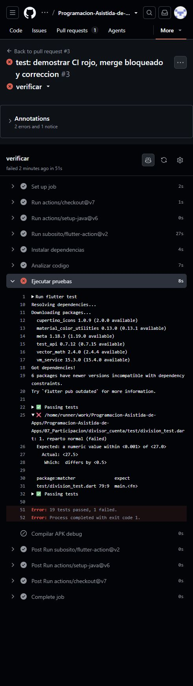
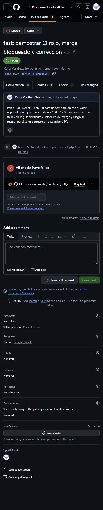
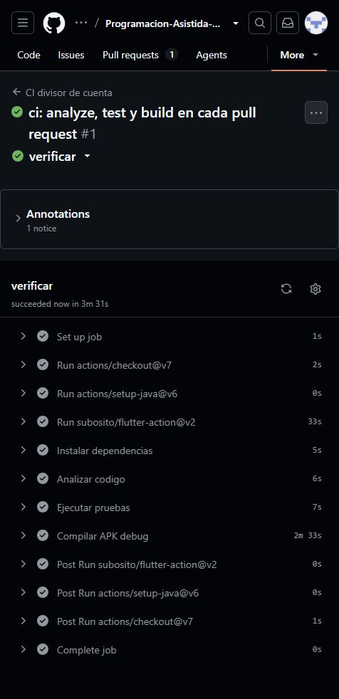
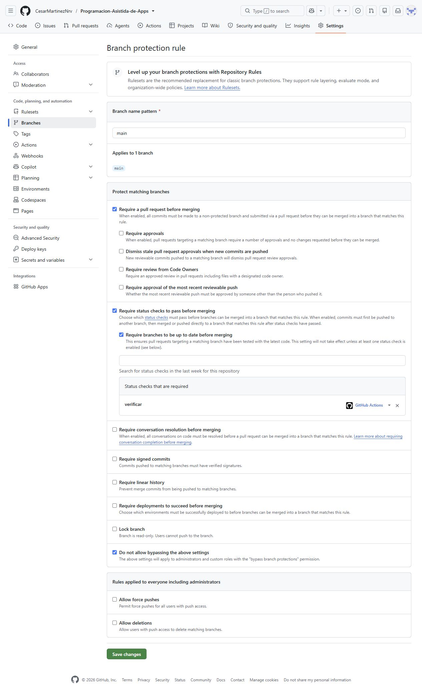
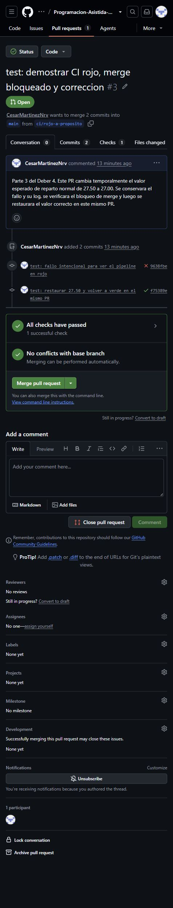
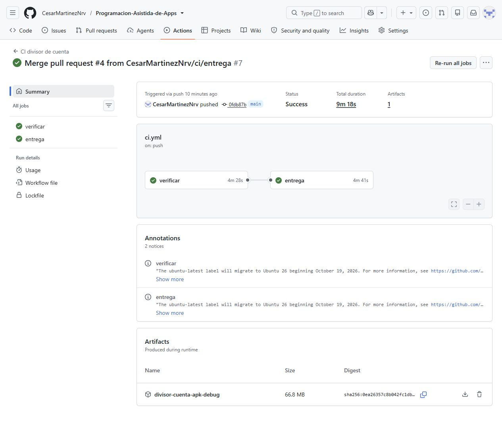

# Deber 4 — Respuestas

Trabajé sobre el divisor de cuenta de la participación y del Deber 3, ubicado en `07_Participacion/divisor_cuenta/`. El workflow y esta entrega están en la raíz del repositorio.

## 1. Mi workflow

```yaml
name: CI divisor de cuenta

on:
  push:
    branches: [main]
  pull_request:

permissions:
  contents: read

defaults:
  run:
    working-directory: 07_Participacion/divisor_cuenta

jobs:
  verificar:
    runs-on: ubuntu-latest
    timeout-minutes: 30
    steps:
      - uses: actions/checkout@3d3c42e5aac5ba805825da76410c181273ba90b1 # v7
        with:
          persist-credentials: false
      - uses: actions/setup-java@b843ebf9b913146b38da2eaa7aeddf76074ae1ad # v6
        with:
          distribution: temurin
          java-version: '17'
      - uses: subosito/flutter-action@1a449444c387b1966244ae4d4f8c696479add0b2 # v2
        with:
          channel: stable
      - name: Instalar dependencias
        run: flutter pub get
      - name: Analizar codigo
        run: flutter analyze
      - name: Ejecutar pruebas
        run: flutter test
      - name: Compilar APK debug
        run: flutter build apk --debug

  entrega:
    needs: verificar
    if: github.event_name == 'push' && github.ref == 'refs/heads/main'
    runs-on: ubuntu-latest
    timeout-minutes: 30
    steps:
      - uses: actions/checkout@3d3c42e5aac5ba805825da76410c181273ba90b1 # v7
        with:
          persist-credentials: false
      - uses: actions/setup-java@b843ebf9b913146b38da2eaa7aeddf76074ae1ad # v6
        with:
          distribution: temurin
          java-version: '17'
      - uses: subosito/flutter-action@1a449444c387b1966244ae4d4f8c696479add0b2 # v2
        with:
          channel: stable
      - name: Instalar dependencias
        run: flutter pub get
      - name: Generar APK para entrega
        run: flutter build apk --debug
      - name: Publicar APK como artifact
        uses: actions/upload-artifact@cf430e030ddbb5b0abf93d22962f4752f3646cd9 # v7
        with:
          name: divisor-cuenta-apk-debug
          path: 07_Participacion/divisor_cuenta/build/app/outputs/flutter-apk/app-debug.apk
          if-no-files-found: error
          retention-days: 30
```

- `analyze`: revisa el código sin ejecutar la app y avisa si encuentra errores o reglas del linter que no se cumplen.
- `test`: ejecuta las pruebas y compara lo que hace el código con los resultados que se esperan.
- `build`: compila la app y comprueba que se pueda generar el APK de depuración.

`pub get` instala las dependencias antes de esos pasos. El job `verificar` corre en cada PR y en los push a `main`. La ruta del proyecto se indica porque este repositorio también tiene otros ejercicios.

## 2. El pipeline en rojo

Cambié el resultado esperado del escenario de reparto normal de `27.50` a `27.00`. Con monto 100, 4 personas y 10% de propina, el resultado correcto seguía siendo 27.50. Por eso la prueba falló.

El log mostró:

```text
Expected: a numeric value within <0.001> of <27.0>
  Actual: <27.5>
   Which: differs by <0.5>
test/division_test.dart 79:9  main.<fn>
Error: 19 tests passed, 1 failed.
```

Las líneas `Expected` y `Actual` dijeron exactamente cuál era la diferencia. `test/division_test.dart 79:9` indicó dónde se hizo la comparación. Como falló `test`, el paso de compilación se omitió.



## 3. CI, delivery y deployment

CI es revisar automáticamente los cambios cuando se integran al proyecto. Continuous delivery deja preparada una entrega después de pasar las verificaciones. Continuous deployment además la despliega a producción automáticamente.

Implementé CI y una introducción a continuous delivery, porque después de pasar CI se genera y guarda el APK para descargarlo. No implementé deployment: no se publica en una tienda ni se instala automáticamente a usuarios. Además, el APK es de depuración, así que todavía no es una versión de producción.

## 4. Merge bloqueado

La protección de `main` exige un PR y que el check `verificar` pase. Cuando la prueba estaba en rojo, GitHub bloqueó el merge. Eso evita integrar directamente un cambio que ya sabemos que rompe una de las verificaciones. Después restauré el valor en el mismo PR y comprobé que el merge se habilitara.



## 5. Revisión del agente

El agente señaló que las etiquetas de las acciones podían cambiar, que checkout conservaba credenciales que no necesitábamos y que faltaba limitar el tiempo de ejecución. Acepté fijar las acciones a sus SHA verificados, usar `persist-credentials: false` y poner un límite de 30 minutos. También acepté que la subida falle si no encuentra el APK. No acepté fijar Flutter a una versión exacta para seguir usando la estable disponible en este ejercicio. Una versión fija también podría ser estable, pero decidí mantener el workflow así de sencillo; eso deja pendiente el riesgo de que una actualización cambie el entorno. No agregué paquetes nuevos ni servicios externos. La revisión completa está en [revision-agente.md](revision-agente.md).

## 6. Lo que garantiza un CI verde

Un CI verde confirma que el código pasó las revisiones configuradas en esa ejecución: análisis, pruebas y compilación. No significa que ya no existan errores, porque las pruebas solo revisan los casos que escribimos.

Por ejemplo, la pantalla podría cortar el resultado al usar un tamaño de letra muy grande en un celular pequeño. Si ninguna prueba revisa esa combinación, las pruebas y la compilación podrían pasar igual.

## 7. Qué detectó el pipeline

Detectó que el resultado esperado del escenario no coincidía con el cálculo real: esperaba 27.00 y la app devolvía 27.50. Lo hizo automáticamente al subir el cambio y bloqueó el merge. En este caso yo sí sabía que estaba mal, porque lo cambié a propósito; no apareció un error inesperado en el código de la app. La comprobación sirvió para demostrar que ese cambio incorrecto no podía entrar a `main`.

## Evidencias y recorrido

- [Proyecto y pruebas del Deber 3 integrados a main — PR #1](https://github.com/CesarMartinezNrv/Programacion-Asistida-de-Apps/pull/1).
- [Parte 1: primer pipeline — PR #2](https://github.com/CesarMartinezNrv/Programacion-Asistida-de-Apps/pull/2) y [ejecución en verde](https://github.com/CesarMartinezNrv/Programacion-Asistida-de-Apps/actions/runs/40515281333).
- [Parte 3: mismo PR con rojo y luego verde — PR #3](https://github.com/CesarMartinezNrv/Programacion-Asistida-de-Apps/pull/3), [ejecución roja](https://github.com/CesarMartinezNrv/Programacion-Asistida-de-Apps/actions/runs/40516052009) y [ejecución corregida](https://github.com/CesarMartinezNrv/Programacion-Asistida-de-Apps/actions/runs/40516591225).
- [Parte 4: entrega del APK — PR #4](https://github.com/CesarMartinezNrv/Programacion-Asistida-de-Apps/pull/4) y [ejecución de entrega en main](https://github.com/CesarMartinezNrv/Programacion-Asistida-de-Apps/actions/runs/40520952550). El artifact se llama `divisor-cuenta-apk-debug` y tiene una retención de 30 días; la captura queda guardada en el repositorio.
- [Log del primer pipeline](evidencias/parte1_log.txt), [fragmento del log rojo](evidencias/parte3_log.txt) y [configuración de protección consultada desde la API](evidencias/proteccion-main.json).








